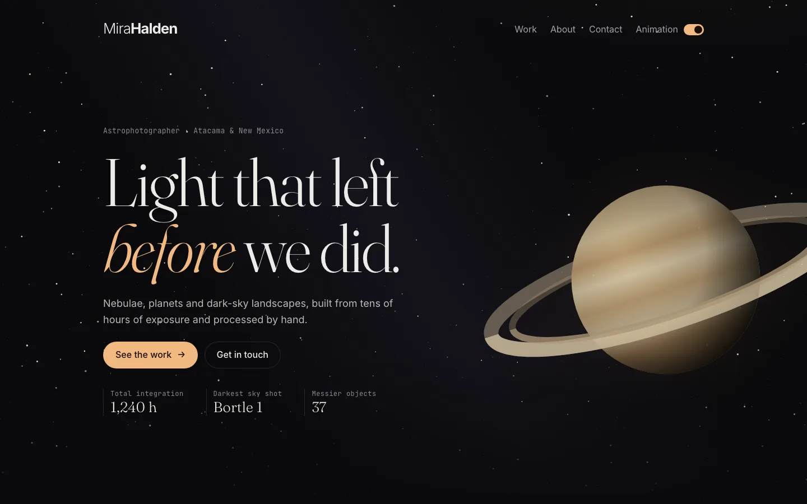
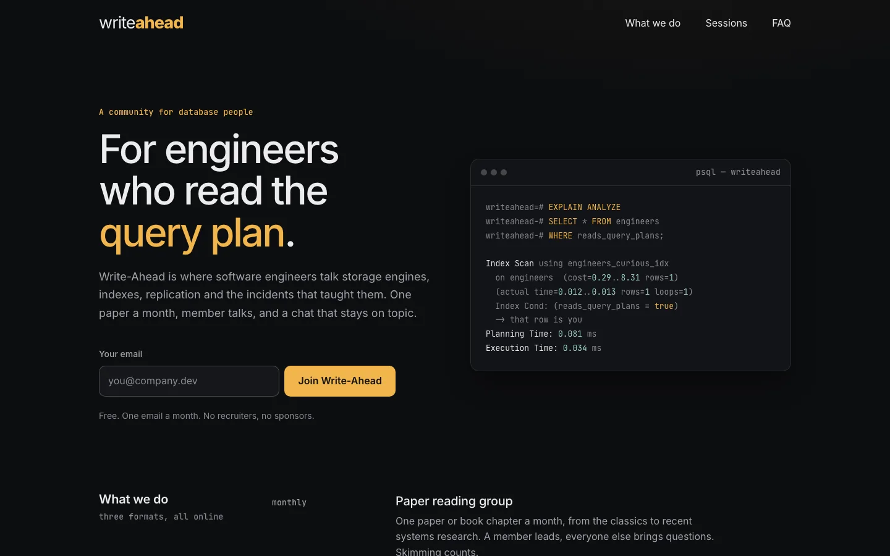

# minimal-modern-ui

A [Claude Code](https://claude.com/claude-code) skill for building and restyling **minimal, modern personal
sites, portfolios, landing pages and blogs** in plain HTML, CSS and a little vanilla JS.

It gives Claude a design compass rather than a template: how to pick a quiet direction, set up design tokens
and shared components so every page matches, lay out each page type, set readable type, add restrained
motion, meet an accessibility and performance baseline, and check the result in a real browser.

**[See example sites built with it →](https://pkafel.github.io/minimal-modern-ui-skill/)**

## Contents

- [Install](#install)
  - [Claude Code (recommended)](#claude-code-recommended)
  - [Claude Code without plugins](#claude-code-without-plugins)
  - [Claude.ai and the Claude desktop app](#claudeai-and-the-claude-desktop-app)
- [Use](#use)
- [Examples](#examples)
- [What's inside](#whats-inside)
- [Contributing](#contributing)

## Install

### Claude Code (recommended)

Inside a Claude Code session, run:

```text
/plugin install minimal-modern-ui --marketplace pkafel/minimal-modern-ui-skill
```

On Claude Code versions older than 2.1.275, add the marketplace first, then install:

```text
/plugin marketplace add pkafel/minimal-modern-ui-skill
/plugin install minimal-modern-ui@minimal-modern-ui-skill
```

The same commands work from your shell as `claude plugin …`. Run `/reload-plugins` or start a new session
to load the skill.

**Update:** open `/plugin`, go to **Marketplaces** and update `minimal-modern-ui-skill` (or turn on
auto-update there). From the shell:

```sh
claude plugin marketplace update minimal-modern-ui-skill
claude plugin update minimal-modern-ui@minimal-modern-ui-skill
```

**Uninstall:** `claude plugin uninstall minimal-modern-ui@minimal-modern-ui-skill`.

> Installed it earlier with `git clone` into `~/.claude/skills/`? Delete that folder after installing the
> plugin, or the skill shows up twice.

### Claude Code without plugins

Clone the repo straight into your skills folder. For all your projects:

```sh
git clone https://github.com/pkafel/minimal-modern-ui-skill ~/.claude/skills/minimal-modern-ui
```

For one project only (run from the project root):

```sh
git clone https://github.com/pkafel/minimal-modern-ui-skill .claude/skills/minimal-modern-ui
```

The folder must be named `minimal-modern-ui`. Start a new session afterwards. To update, run `git pull` inside
the folder.

### Claude.ai and the Claude desktop app

Skills are uploaded as a ZIP whose root is the skill folder. Build one with only the skill files:

```sh
git clone https://github.com/pkafel/minimal-modern-ui-skill
cd minimal-modern-ui-skill
git archive --prefix=minimal-modern-ui/ -o minimal-modern-ui.zip HEAD SKILL.md references LICENSE THIRD_PARTY_NOTICES.md
```

Then upload `minimal-modern-ui.zip` in the **Skills** section of Claude's settings and turn it on.

## Use

Ask for what you want and Claude loads the skill when it fits:

> Build me a minimal personal site with a blog, dark and light mode.

> Restyle this landing page so it looks clean and modern.

Or invoke it directly: type `/` in Claude Code and pick **minimal-modern-ui** from the list.

## Examples

Each example was built from a single prompt, then refined in a short conversation. Browse them live in the
**[gallery](https://pkafel.github.io/minimal-modern-ui-skill/)**.

### Astrophotographer portfolio

[](https://pkafel.github.io/minimal-modern-ui-skill/examples/astrophotographer/)

> Design a web page for a photographer who is into space, planets and stars photography. Use /minimal-modern-ui skill.

### Database community landing page

[](https://pkafel.github.io/minimal-modern-ui-skill/examples/database-community/)

> Use /minimal-modern-ui to create a landing page for a community of software engineers interested in databases.

Names, dates and links in the examples are made up.

## What's inside

| File | Contents |
|---|---|
| `SKILL.md` | Workflow, direction, shared styles and components, page recipes (landing, personal, blog index, blog post) with page essentials, typography, color, motion, interaction patterns, the firm quality baseline, browser verification |
| `references/snippets.md` | Copy-paste building blocks: tokens (light and dark), base layer, skip link, header, prose, post list, buttons and fields, signup form, page-load fade, scroll reveals, FAQ disclosure, and more |
| `references/defaults.md` | Concrete default values (spacing, header and heading sizes, contact rows, testimonials) and fixes for common CSS and motion pitfalls |
| `references/interface-checklist.md` | Detailed interaction, form, content, motion and performance checks |
| `references/templates.md` | Measurements from ten landing-page templates, to calibrate the eye |
| `.claude-plugin/` | Plugin and marketplace manifests for `/plugin install` |
| `site/` | The [example gallery](https://pkafel.github.io/minimal-modern-ui-skill/), published to GitHub Pages; not part of the skill |

## Contributing

Issues and pull requests are welcome, especially defaults learned from real sites built with the skill. Keep
additions framework-agnostic and within scope (personal sites, landing pages, blogs). To add an example, put
the site in `site/examples/<name>/` with relative paths only, add a screenshot to `site/assets/` and a card to
`site/index.html`.
